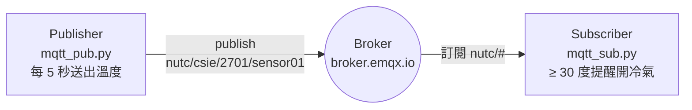

# 15. MQTT — 發布／訂閱訊息實作

MQTT 是物聯網常用的輕量訊息協定。裝置不直接互相連線，而是都連到中間的 **Broker**：**Publisher** 把訊息發布到某個主題（topic），**Subscriber** 訂閱主題後，Broker 會把符合的訊息轉送過去。本單元用公用 Broker 模擬「溫度感測器 → 冷氣提醒」的流程。



簡報：[MQTT 簡介（HackMD）](https://hackmd.io/@wiimax/ict_mqtt#/)

## 📒 教材清單

| 檔案 | 學習重點 |
|---|---|
| [`MQTT_Demo_Publisher.ipynb`](MQTT_Demo_Publisher.ipynb) | [](https://colab.research.google.com/github/willismax/MediaSystem-Python-Course/blob/main/15.MQTT/MQTT_Demo_Publisher.ipynb) 發布端：連線 Broker、把資料包成 JSON 發布 |
| [`MQTT_Demo_Subscriber.ipynb`](MQTT_Demo_Subscriber.ipynb) | [](https://colab.research.google.com/github/willismax/MediaSystem-Python-Course/blob/main/15.MQTT/MQTT_Demo_Subscriber.ipynb) 訂閱端：callback、萬用字元訂閱、依內容判斷 |
| [`mqtt_pub.py`](mqtt_pub.py) | 與 Publisher 筆記本相同的腳本，可在自己電腦執行 |
| [`mqtt_sub.py`](mqtt_sub.py) | 與 Subscriber 筆記本相同的腳本，會略過不是溫度格式的訊息 |
| [`test_mqtt_messages.py`](test_mqtt_messages.py) | 不連網路，測試訊息打包與解析 |

## 🚀 在 Colab 執行

1. 用上表的 **Open in Colab** 分別在兩個分頁開啟 Subscriber 與 Publisher。
2. 先在 Subscriber 分頁依序執行儲存格，看到 `connected with result code Success` 後保持執行。
3. 再到 Publisher 分頁執行，Subscriber 分頁會每 5 秒收到一筆溫度。
4. 要停止時，按儲存格左側的停止鍵。

全班同時執行時，大家都發布到同一個主題，Subscriber 會收到所有同學的訊息，這正好可以觀察「一對多」的發布／訂閱。

## 💻 在自己電腦執行

需要 Python 3.10 以上版本。開兩個終端機視窗：

```bash
cd 15.MQTT
uv venv
uv pip install -r requirements.txt

# 視窗 1
uv run mqtt_sub.py

# 視窗 2
uv run mqtt_pub.py
```

也可以用 `python -m pip install -r requirements.txt` 安裝後，以 `python mqtt_sub.py`、`python mqtt_pub.py` 執行。Broker、主題、QoS 與發布筆數都寫在腳本最上方的常數，直接修改即可。

執行測試（不需要連線到 Broker）：

```bash
pytest -q
```

## 重要觀念

**主題（topic）** 用 `/` 分層，例如 `nutc/csie/2701/sensor01`。訂閱時可用萬用字元：

| 訂閱 | 會收到 | 不會收到 |
|---|---|---|
| `nutc/csie/2701/sensor01` | 只有這個主題 | `nutc/csie/2701/sensor02` |
| `nutc/csie/+/sensor01` | `nutc/csie/2701/sensor01`、`nutc/csie/2702/sensor01` | `nutc/csie/2701/room/sensor01` |
| `nutc/#` | `nutc/` 底下所有層級 | `tcnr/class/01/sensor01` |

**QoS（服務品質）** 決定送達保證：

| QoS | 意義 | 代價 |
|---|---|---|
| 0 | 最多一次：送出就不管 | 最快，網路不穩可能遺失 |
| 1 | 至少一次：Broker 回覆確認，沒收到就重送 | 可能重複收到 |
| 2 | 剛好一次：四次交握確保不重複 | 最慢 |

**callback** 是「事件發生時才被呼叫的函式」。Subscriber 把 `on_connect`、`on_message` 交給 client，`loop_forever()` 負責等待網路事件並呼叫它們。把 `subscribe()` 寫在 `on_connect` 裡，斷線重連後也會自動重新訂閱。

## 練習

1. 把 Publisher 的 `TOPIC` 改成 `"tcnr/class/你的座號/sensor01"`，Subscriber 改訂閱 `"tcnr/#"`。
2. 把 Broker 改為 `broker.hivemq.com`，Publisher 與 Subscriber 要同步修改。
3. 把 `QOS` 改成 1，觀察程式行為是否不同。
4. 修改 `mqtt_sub.py` 的 `advice()`：溫度低於 20 度時回傳「該蓋棉被啦」，並在 `test_mqtt_messages.py` 補一個測試。
5. 在訊息中加入濕度 `Humidity`，讓 Subscriber 同時顯示溫度與濕度。

## ⚠️ 注意事項

- 公用 Broker 沒有帳號密碼，連接埠 1883 也不加密，任何人都能訂閱同一個主題。只傳練習用的模擬資料，不要傳個人資料、密碼或金鑰。
- 公用 Broker 上可能有別人發布的任意內容，所以 `mqtt_sub.py` 會先檢查格式，不是溫度的訊息直接略過。
- 正式專案應使用自己架設或有帳號驗證的 Broker（例如 Mosquitto、EMQX），並啟用 TLS（連接埠 8883）。

## 疑難排解

| 狀況 | 可能原因 |
|---|---|
| 出現 `DeprecationWarning: Callback API version 1 is deprecated` | 使用舊寫法 `mqtt.Client()`。paho-mqtt 2.x 請改用 `mqtt.Client(mqtt.CallbackAPIVersion.VERSION2)`，`on_connect` 的參數也改為 `(client, userdata, flags, reason_code, properties)` |
| Subscriber 沒收到訊息 | 兩邊的 Broker 或主題不一致；或 Publisher 先送、Subscriber 後連線（MQTT 預設不保留舊訊息） |
| 連線逾時 | 所在網路封鎖 1883 連接埠，可改用手機熱點或換一個 Broker |

## 🔗 參考資料

- [Eclipse Paho MQTT Python Client 文件](https://eclipse.dev/paho/files/paho.mqtt.python/html/)
- [paho-mqtt 2.0 遷移說明](https://eclipse.dev/paho/files/paho.mqtt.python/html/migrations.html)
- [MQTT 官方網站](https://mqtt.org/)
